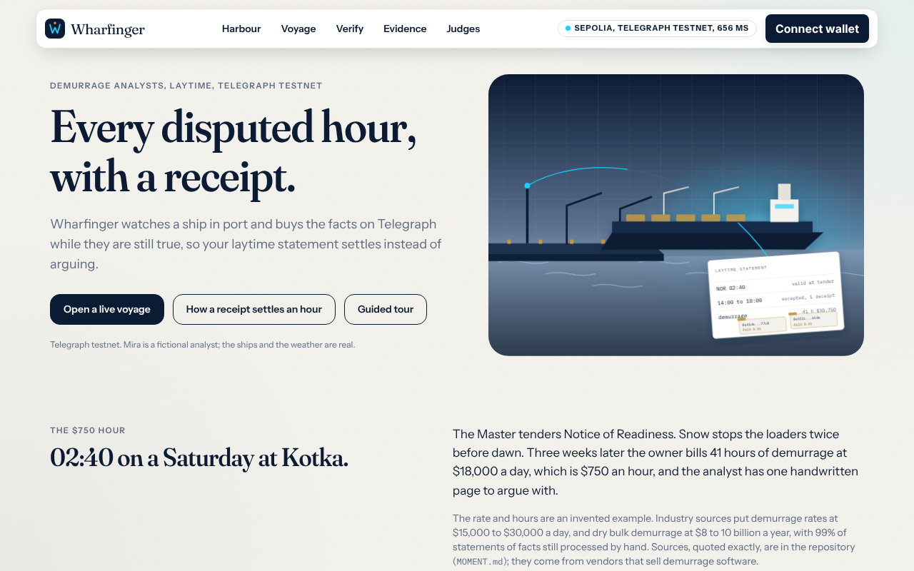
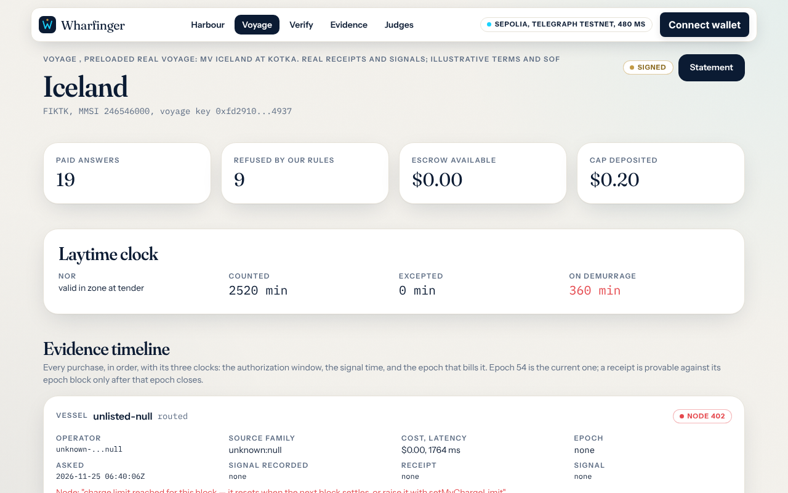
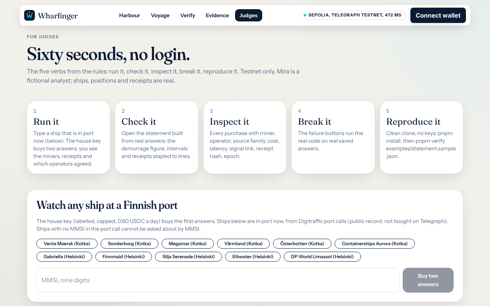
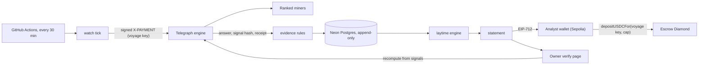

<p align="center"></p>

# Wharfinger

**Every disputed hour of a port call, with a receipt the shipowner can check.**

[Live app](https://wharfinger-kinnoskis-projects.vercel.app) · [For judges](https://wharfinger-kinnoskis-projects.vercel.app/judge) · MIT licence · Telegraph testnet only



Wharfinger watches a ship in port and buys the facts on Telegraph while they are still true: where the ship is, how long the
queue is, whether the loaders stopped for snow. When the demurrage invoice arrives three weeks later, the laytime analyst signs
a time sheet where every contested hour is backed by paid answers, and the owner recomputes it.

| | |
|---|---|
| Live app | https://wharfinger-kinnoskis-projects.vercel.app (no login to read; a wallet only to fund or sign) |
| For judges | `/judge`, a 60 second walk with failure buttons |
| Track and mission | Apps and Agents, Mission 08 Commodities |
| Built with | Telegraph escrow rail, Engine Ask, signal, ledger and epoch block endpoints; Next.js; viem; Neon Postgres |
| Measured | `/api/stats` recomputes every number from the stored purchases |

| Voyage evidence timeline | Judge page |
|---|---|
|  |  |

## The problem

At 02:40 on a Saturday a bulk carrier tenders Notice of Readiness (NOR) at Kotka. Snow stops the loaders twice before dawn. Three
weeks later the owner bills 41 hours of demurrage at $18,000 a day, which is $750 an hour, and the analyst has one handwritten
Statement of Facts (SOF) to argue with. The rate and hours are an invented example; Mira Kallio, the analyst, is fictional.

| What is true | Source |
|---|---|
| Dry bulk accounts for $8 to 10 billion in demurrage fees a year, roughly 6 to 8% of freight spend; rates run $15,000 to $30,000 a day | Marcura, "Demurrage claims leakage" |
| 99% of statements of facts are processed manually, an estimated 12 million hours a year | same page |
| A single miscategorised six-hour weather event at $20,000 a day changes a claim by $5,000 | Voyager, "The Basics of Bulk Shipping Demurrage" |

Every figure is asserted by `tests/sources.test.ts` against the exact quoted sentence in `docs/sources/quotes.json`. These
sources are vendors that sell demurrage software; see `MOMENT.md`.

## What Wharfinger does

1. The analyst enters the vessel and the charter-party terms and funds a per-voyage key from her own wallet with
   `depositUSDCFor`. The cap lives in the escrow, not in our code.
2. Every 30 minutes the watcher buys vessel position, port queue and conditions on Telegraph, unattended.
3. Two operators must agree before a fact can move an hour. Wrong place, stale, empty and disagreeing answers are refused, kept
   with a reason, and re-bought from another operator.
4. Code, not a model, classifies each interval as counting, excepted, or REVIEW. The analyst resolves REVIEW with a reason and
   signs with her wallet (EIP-712). The owner recomputes every line and countersigns or disputes named lines.
5. The statement leaves as PDF, XLSX (the column layout desks use) and JSON.

## Explore it in 2 minutes

1. Open `/judge`, pick a ship that is in port now, press **Buy two answers**. The house key (labelled, capped) buys live; you see
   the miners, receipts, and which operators agreed.
2. Open the preloaded voyage: real receipts and signals for MV Iceland at Kotka, with illustrative terms and SOF.
3. Open `/verify/iceland-fiktk-preloaded` and press **Recompute in this browser**.
4. Press **Tamper one minute** on `/judge`: the same recompute fails at that line.
5. Offline, from a clean clone with no keys:

```bash
pnpm install
pnpm verify examples/statement.sample.json
```

## How it works

Telegraph miners perceive the port, code decides each interval, a person signs.



```text
tick: lease (voyage, 30 min slot) -> escrow available? -> routed ask -> checks -> pinned re-buy from another operator
      -> corroborate (two operators, source family kept visible) -> store append-only -> engine snapshot
```

Packages: `laytime` (pure engine), `evidence` (rules), `telegraph` (escrow client), `watch` (tick), `statement` (signing and
verification), `truth` (public-record readers), `db` (schema). The app is `apps/web`.

## Why Telegraph

- **The receipt is a timestamped fact.** A paid authorization lives at most two minutes and its nonce works once, so an answer
  is bound to the minute it was bought (`DISCOVERY.md`). Each purchase keeps three clocks: the authorization window, the signal
  time and the epoch.
- **Escrow caps.** The node refuses the next answer when the deposit runs out, and `setMyChargeLimit` caps each block.
- **Signals recompute.** keccak256 of the signal payload re-derives offline (`packages/telegraph/src/index.ts`).
- Every call, with file and line, is in `SDK_SURFACE.md`; a test fails if a line drifts.

## What it will not do

| Refusal | Where |
|---|---|
| No hour moves without a receipt bought while it happened | `packages/laytime`, tested |
| An answer that is stale, for the wrong place, for the wrong vessel, empty or out of range is refused | `packages/evidence` |
| Our own miner never counts toward corroboration | `packages/evidence`, `packages/statement` |
| A model never sets a number | no model is called anywhere |
| Never retry a refused payment with another key | `packages/watch` |

## Measured

Phase 1 probe, 2026-11-25 (`PLATFORM_PROBE.md`): 28 paid asks, 22 answers. Four operator wallets returned the right position at
95 to 161 seconds old, but all four relay one public feed, so every receipt shows its source family and "one upstream" where it
applies. Five answers were wrong, stale or empty (latitude equal to longitude, a list of other ships, a 25 hour old position, null
coordinates) and one miner errored. A routed port ask for Kotka returned Hanko. Misses are named, not hidden.

## Live, substituted, designed

| Item | Status |
|---|---|
| Routed and pinned asks, escrow authorization, receipts, signals | live |
| `depositUSDCFor` funding and `setMyChargeLimit` from a voyage key | live (tested end to end on the node) |
| `requestWithdraw` sweep | requested; `executeWithdraw` waits for the node's ledger root |
| Position corroboration across independent sources | designed; today operators share one feed |
| Hourly rain | not purchasable; weather rule uses a daily fact plus an SOF line (`THESIS.md`) |
| Kotka port queue | not purchasable (miners answer for Hanko or return empty figures) |
| Zone geometry | draft derived from ships at berth, not chart-derived port limits |
| Evaluator and Miner entries | not started |

## Judging criteria map

| Criterion (weight) | Where to look |
|---|---|
| Technical quality and mainnet readiness (35) | `packages/*/test` (108 tests, 10,000-run property tests), `MAINNET.md`, `SECURITY.md`, `RUNBOOK.md`, `e2e/smoke.mjs` |
| Commercial viability (25) | Commercial summary below, `MOMENT.md`, `RISK.md` |
| Independent adoption (10) | none yet; stated plainly in `GROWTH.md` |
| Telegraph integration (5) | `SDK_SURFACE.md`, `PLATFORM_PROBE.md` |
| Reproducibility and proof (5) | `pnpm verify`, `TUTORIAL.md`, `JUDGE.md` |
| Growth, education, activation (20) | `TUTORIAL.md`, `GROWTH.md` |

## Commercial summary

1. **Who is it for?** A post-fixture demurrage analyst at a physical commodity trading desk; each handles dozens of voyages a month.
2. **What does it improve?** Today she retypes a handwritten SOF and argues from memory; here each contested hour carries paid receipts the owner can recompute. Cost: about $0.01 per answer; an estimated $1.20 to $1.60 per 48 hour stay (to be measured on a recorded voyage).
3. **What does it do today?** Watches a vessel, buys and checks answers, builds and signs a statement, verifies it in the browser and offline. Testnet only.
4. **Why adopt it?** Demurrage disputes are decided on timestamped evidence and missed time bars are expensive. What remains: chart-derived port limits, independent position sources, a real customer.
5. **How can someone try it?** The live app and `pnpm verify`. Maintained by 0xkinno.

## Recovery

Duplicate tick: a lease per voyage per slot refuses it. Node refusal for balance: the watcher marks BUDGET_SPENT and holds. Miner
error: not billed; the next operator is tried. Withdraw stalls: shown as pending since. Restart: leases and purchases are durable.

## Run it

```bash
git clone https://github.com/0xkinno/wharfinger && cd wharfinger
pnpm install
pnpm test                       # 108 tests, no keys
pnpm verify examples/statement.sample.json
```

Deploy and environment variables: `DEPLOY.md`. The app works without secrets by serving committed real fixtures; add
`DATABASE_URL` and keys to turn on live voyages.

## Disclosures

Built with substantial AI assistance (`DISCLOSURES.md`). Hackathon entry; the prize incentive applies. Mira is fictional; the
charter terms and SOF in the sample are illustrative; receipts and signals are real testnet answers.

## Documentation

`MOMENT.md`, `DISCOVERY.md`, `THESIS.md`, `RISK.md`, `SPONSOR_INTEL.md`, `PLATFORM_PROBE.md`, `FINDINGS.md`, `FRICTION_REPORT.md`,
`SDK_SURFACE.md`, `MISSION_FIT.md`, `LANE_MAP.md`, `JUDGE_TASTE.md`, `DESIGN.md`, `JUDGE.md`, `TUTORIAL.md`, `GROWTH.md`,
`SECURITY.md`, `MAINNET.md`, `RUNBOOK.md`, `DEPLOY.md`, `DISCLOSURES.md`, `RULES_EXTRACT.md`, `PROGRESS.md`, `task.md`.

MIT licence.
