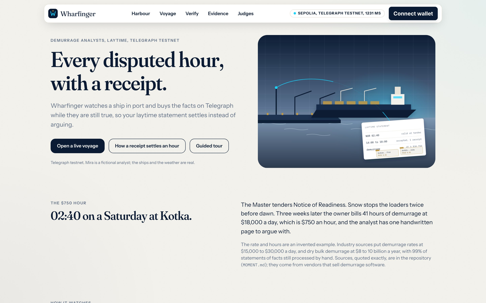
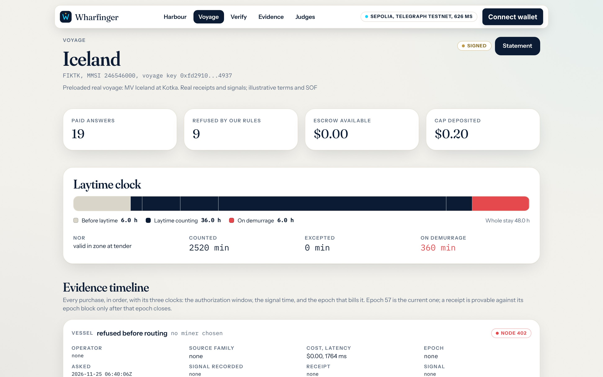
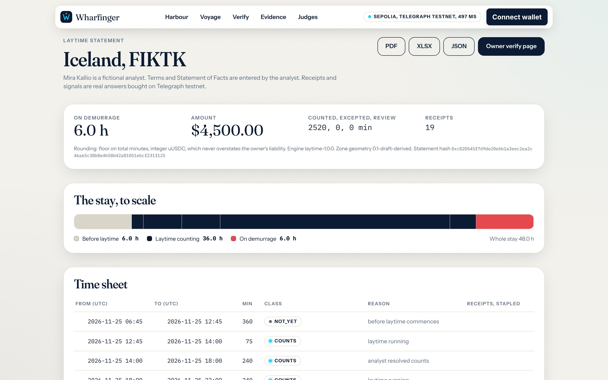
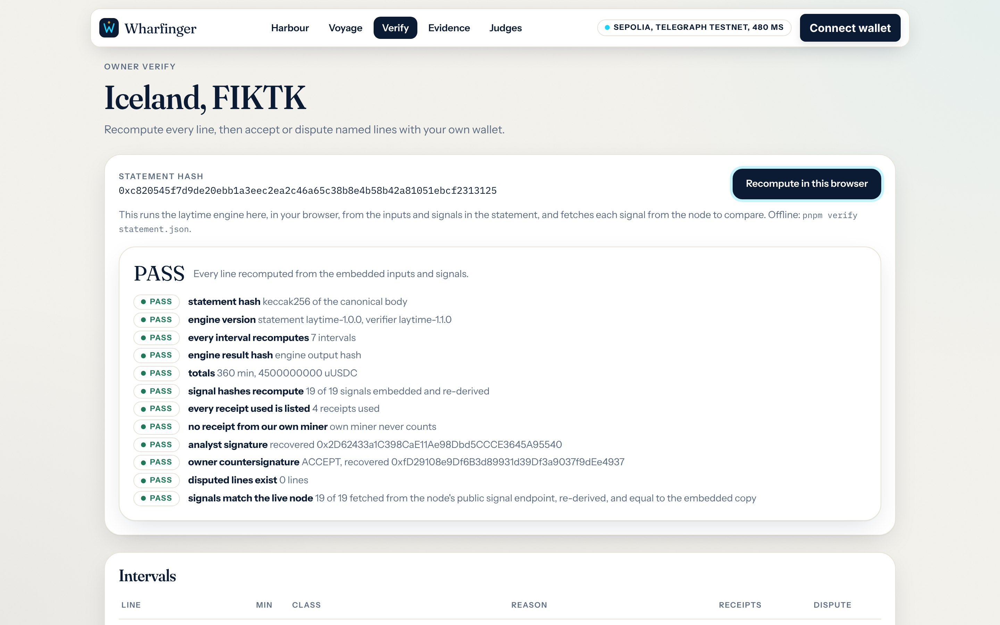
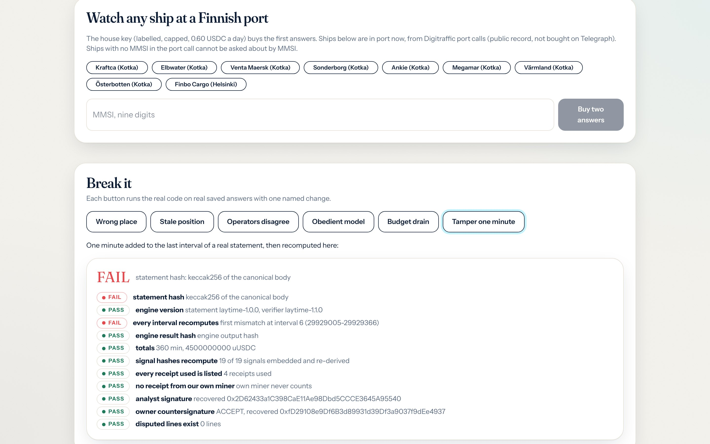
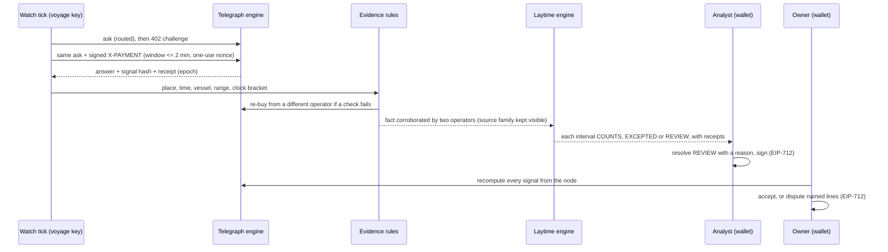

<p align="center"></p>

<h1 align="center">Wharfinger</h1>

<p align="center"><b>Every disputed hour of a port call, with a receipt the shipowner can check.</b></p>

<p align="center">
  <a href="https://wharfinger-kinnoskis-projects.vercel.app">Live app</a> ·
  <a href="https://wharfinger-kinnoskis-projects.vercel.app/judge">60 second judge path</a> ·
  <a href="TUTORIAL.md">20 line tutorial</a> ·
  <a href="PLATFORM_PROBE.md">What the network got wrong</a>
</p>

<p align="center">
  <a href="https://github.com/0xkinno/wharfinger/actions/workflows/ci.yml"></a>
  
  
  
</p>



A ship sits in port for three days. Three weeks later the owner bills 41 hours of demurrage, and the charterer's analyst has one
handwritten page to argue with. **Wharfinger was watching.** It bought the facts on Telegraph while they were still true: where
the ship was, how long the queue was, whether the loaders stopped for snow. Each contested hour carries paid receipts, and the
owner recomputes every line without trusting us.

> *Wharfinger: the harbour officer who keeps the record of when ships arrive, berth and sail.* Pronounced WOR-fin-jer.

## Claims you can check today

| Claim | Check it |
|---|---|
| A signed laytime statement recomputes from its own receipts, in a browser or offline | `/verify/iceland-fiktk-preloaded`, or `pnpm verify examples/statement.sample.json` |
| One flipped minute is caught at that line | Press **Tamper one minute** on `/judge` |
| A voyage key spends funds another wallet deposited, capped by the escrow | `evidence/probe/paid/stage_limit.json`, and the wallet suite below |
| Funded with $0.05, the watcher stops: 5 paid answers, then the node's own refusal | `/api/judge/fault?mode=drain` (recorded live run) |
| Wrong, stale and empty answers are refused and re-bought, not trusted | `/evidence`: every refusal with its reason, from real purchases |
| Every wallet action works for real: connect, fund, sign, countersign | `node e2e/wallet.mjs` (real Sepolia transactions and signatures) |
| Every number on the site comes from stored purchases | `/api/stats`, `/api/status`, `/trace` |
| A payment is held, escalated or blocked until the statement, both keys and a paid screening receipt check out | `/settle` (decisions recompute in your browser), `packages/settle` |

## See it

| The stay, to scale, with every purchase behind it | The statement the analyst signs |
|---|---|
|  |  |
| **The owner recomputes it in the browser** | **Break it: one minute changed** |
|  |  |

## What the network got wrong, live

Telegraph is a young market. Every answer Wharfinger buys passes through rules written from real failures, all of them bought and
receipted on the testnet on 2026-11-25 (`PLATFORM_PROBE.md`, `packages/evidence`):

| What a miner returned | Looked like | What Wharfinger did |
|---|---|---|
| Latitude equal to longitude, 3,710 km from the ship | A valid answer, every field `ok` | Refused `WRONG_PLACE` |
| A position 25 hours old, for a ship that was moored | A valid answer, every field `ok` | Refused `STALE` |
| A list of other vessels instead of the one asked | A valid answer | Refused `WRONG_VESSEL` |
| Port queue for "Kotka": the port code for Hanko | A valid answer at rank 2 | Refused `WRONG_PLACE`; Kotka's queue is shown as not purchasable |
| Four operator wallets agreeing on a position | Independent corroboration | Labelled **one upstream**: all four relay one public feed |

## How it works

*Telegraph miners perceive the port, code decides each interval, a person signs.*



A paid answer is a timestamped fact because Telegraph sells it only while it is current: the authorization lives at most two
minutes and its nonce works once. Each purchase keeps **three clocks** that nobody on our side controls: the authorization window,
the node's signal time, and the epoch that bills it.

The weather rule is the clearest example of "code decides". Hourly rain cannot be bought, so an hour is excepted for weather only
with an SOF stop line **and** two operators reporting at least 1 mm for the day; otherwise it goes to REVIEW (`THESIS.md`).

## Before money moves

A demurrage invoice is only as good as the statement behind it. `/settle` shows a gate that decides whether a payment may go out:
the statement must recompute, the analyst and owner keys must match the mandate, the payee must have a clear, paid sanctions
screening receipt, and the amount must sit inside the payer's authority. A tampered statement is **blocked**, a missing
countersignature **holds**, a sanctions match **escalates** to a person, and only a clean case **releases**. The gate never moves
money; a rail does, and the gate then checks what the chain recorded. The released case was paid on Solana devnet in
[this transaction](https://explorer.solana.com/tx/3uAkgU3WL2E1XrXA9JZ5ckaJhKaciMCxKu8ubRjv68iZcRTMp141VcDcAWqMVM2fcAGKQHrCjpNFDA2T6SfQ15M5?cluster=devnet); the same run shows the other three cases paying nothing.

## Explore it in two minutes

1. `/judge`: pick a ship that is in port now and press **Buy two answers**. The labelled house key buys live; you see miners,
   receipts and which operators agreed. A stale first answer is refused and re-bought on screen.
2. `/voyage/iceland-fiktk-preloaded`: the whole stay as a bar, every purchase with its three clocks.
3. `/verify/iceland-fiktk-preloaded`: **Recompute in this browser**. PASS means the engine, every signal hash and every signal on
   the node agree.
4. `/judge`: **Tamper one minute**, and the same recompute fails at that line.

```bash
pnpm install && pnpm verify examples/statement.sample.json   # offline, no keys
```

## Why Telegraph

| Telegraph feature | What Wharfinger does with it | Where |
|---|---|---|
| Routed ask, then pinned ask | First buy is always routed; a pinned ask is only a re-buy after a failed check | `packages/watch` |
| Escrow authorization (EIP-191) | Fresh nonce each call, window capped at 120 s, per-answer cap in code | `packages/telegraph` |
| `depositUSDCFor` and `setMyChargeLimit` | The analyst's wallet funds a per-voyage key; the cap lives in the escrow | `apps/web/app/api/voyages` |
| Receipts, signals, ledger, epoch blocks | Stored per purchase; signals re-derived offline and in the browser | `packages/statement` |

Every call, with file and line, is in `SDK_SURFACE.md`; a test fails if a line drifts.

## What it will not do

| Refusal | Enforced in |
|---|---|
| Move an hour without a receipt bought while it happened | `packages/laytime`, 10,000-run property tests |
| Trust a miner: stale, wrong place, wrong ship, empty, out of range, disagreeing | `packages/evidence` |
| Count our own miner toward corroboration | `packages/evidence`, `packages/statement` |
| Let a model set a number | no model is called anywhere |
| Retry a refused payment with another key | `packages/watch` |

## Live, substituted, designed

| Item | Status |
|---|---|
| Routed and pinned asks, escrow rail, receipts, signals, epoch reads | **live** |
| Voyage funding, per-block cap, watcher tick, signed statements, countersignature | **live**, run end to end with real transactions |
| PDF, XLSX and JSON export; browser and offline verification | **live** |
| Corroboration across independent sources | **designed**: today operators share one feed, shown as one upstream |
| Hourly rain | **not purchasable**; daily fact plus SOF line |
| Kotka port queue | **not purchasable**; Helsinki and Turku work |
| Zone geometry | **draft**, derived from ships at berth, not chart-derived port limits |
| Withdraw sweep (`executeWithdraw`) | requested; waits for the node's ledger root |
| Settlement gate (hold, escalate, block, release) | **live** as code and page; two real screening receipts from Telegraph |
| Solana devnet transfer of a released amount, read back from the chain | **live on devnet**: [transaction](https://explorer.solana.com/tx/3uAkgU3WL2E1XrXA9JZ5ckaJhKaciMCxKu8ubRjv68iZcRTMp141VcDcAWqMVM2fcAGKQHrCjpNFDA2T6SfQ15M5?cluster=devnet) pays $4,500.00 of a devnet test token with the statement hash in the memo; the amount, payee and memo are read back from the chain and checked (`scripts/solana-settle.ts`) |
| Anjoman Apps directory listing (category Commerce) | **live** since 2026-11-28 |
| Unattended voyage | **running**: MV Kraftca at Kotka, funded with $5, bought answers by a scheduled GitHub workflow with nobody involved. GitHub starts scheduled runs only a few times a day, so each run ticks every 30 minutes for about five and a half hours and there are gaps between runs; complete when the ship sails |
| Mission 08 issue body | read in full and mapped to the routes (`MISSION_FIT.md`) |
| Miner: Wharfinger Port Queue (`LIVE_PORT_CONGESTION_GENERAL`, Kotka answered correctly) | **built and live**, endpoint tested; registration is the owner's step on Anjoman (`MINER.md`) |
| Evaluator material: real preference pairs for `VESSEL_TELEMETRY_VERIFY_GENERAL` | **built**, labelled against Digitraffic AIS; upload is the owner's step on Anjoman (`EVALUATOR.md`) |

## Commercial summary

1. **Who is it for?** A post-fixture demurrage analyst at a physical commodity trading desk, who argues dozens of invoices a month.
2. **What does it improve?** Today she retypes a handwritten Statement of Facts and argues from memory. Here each contested hour has
   receipts the owner can recompute. Cost: $0.01 per answer; an estimated $1.20 to $1.60 per 48 hour stay.
3. **What does it do today?** Watches a ship in port, buys and checks answers, builds a statement, signs it, verifies it. Testnet only.
4. **Why adopt it?** Disputes are won on timestamped evidence and time bars are expensive. Still missing: chart-derived port
   limits, independent position sources, a real customer.
5. **How can someone try it?** The live app and `pnpm verify`. Maintained by 0xkinno.

## Judging criteria map

| Criterion | Where to look |
|---|---|
| Technical quality and mainnet readiness | tests and property tests in `packages/*/test`, `e2e/`, `MAINNET.md`, `SECURITY.md`, `RUNBOOK.md` |
| Commercial viability | the summary above, `MOMENT.md` (every figure asserted by a test), `RISK.md` |
| Independent adoption | none yet; stated plainly in `GROWTH.md` |
| Telegraph integration | `SDK_SURFACE.md`, `PLATFORM_PROBE.md`, `FRICTION_REPORT.md` |
| Reproducibility and proof | `pnpm verify`, `TUTORIAL.md`, `JUDGE.md` |
| Growth and education | `TUTORIAL.md`, `GROWTH.md` |

## Recovery

A duplicate tick is refused by a lease per voyage per 30 minute slot. A node refusal for balance marks BUDGET_SPENT and holds.
A miner error is not billed and the next operator is tried. A restart loses nothing: leases and purchases are durable.

## Run it

```bash
git clone https://github.com/0xkinno/wharfinger && cd wharfinger
pnpm install
pnpm test                 # unit and property tests, no keys
pnpm verify examples/statement.sample.json
BASE=<url> node e2e/smoke.mjs   # browser suite: console, overflow, overlap, accessibility
```

The app works without secrets by serving committed real fixtures. `DEPLOY.md` lists the variables that turn on live voyages.

## Disclosures

Built with substantial AI assistance (`DISCLOSURES.md`). Hackathon entry; the prize incentive applies. Mira Kallio is a fictional
analyst; the charter terms and Statement of Facts in the sample are illustrative; receipts and signals are real testnet answers.
Industry figures come from vendors that sell demurrage software.

## Documentation

`MOMENT` · `DISCOVERY` · `THESIS` · `RISK` · `MISSION_FIT` · `SPONSOR_INTEL` · `PLATFORM_PROBE` · `FINDINGS` · `FRICTION_REPORT` ·
`SDK_SURFACE` · `DESIGN` · `JUDGE` · `TUTORIAL` · `GROWTH` · `SUBMISSION_TELEGRAPH` · `SECURITY` · `MAINNET` · `RUNBOOK` · `DEPLOY` ·
`DISCLOSURES` · `RULES_EXTRACT` · `LANE_MAP` · `JUDGE_TASTE` · `PROGRESS`. MIT licence.
